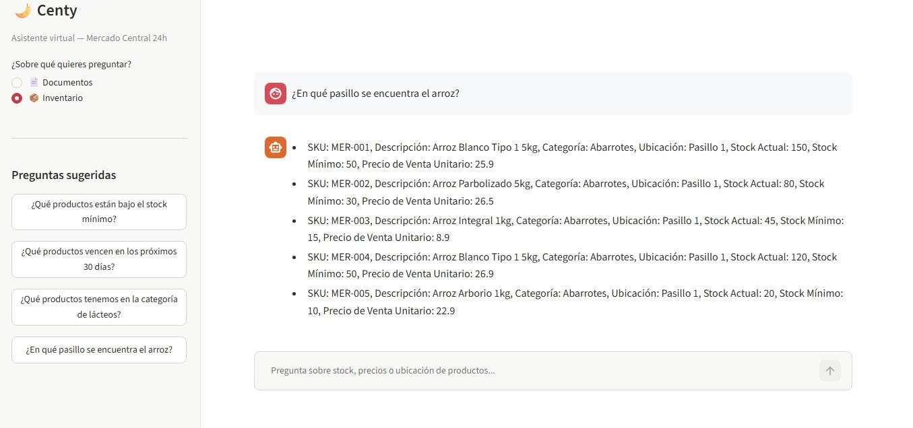
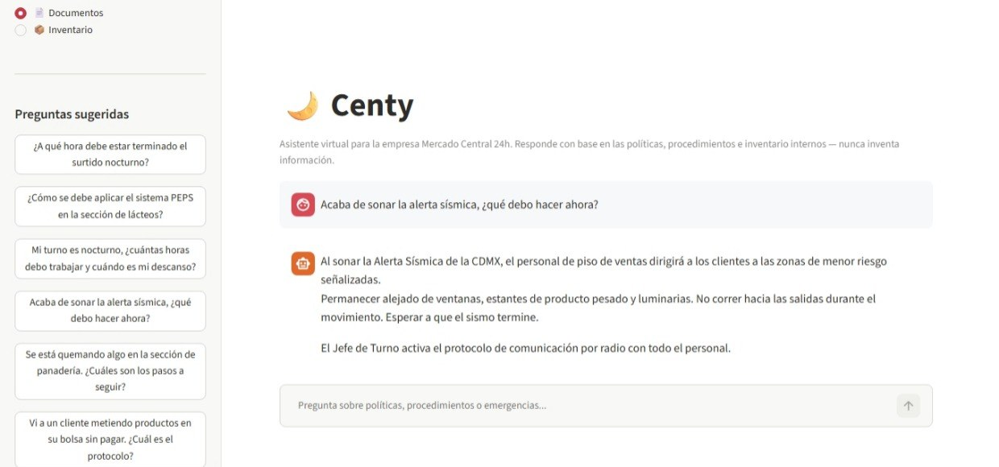

# Agente de IA para Documentos Internos (RAG híbrido)

Agente de IA que responde preguntas en lenguaje natural sobre los documentos internos de una empresa (PDF) y sobre su inventario (XLSX), sin abrir los archivos a mano.

> **El caso en 30 segundos**
> - **Problema:** responder preguntas sobre políticas internas (PDF) y sobre inventario (XLSX) sin que un LLM pequeño invente cifras.
> - **Decisión:** arquitectura híbrida: RAG para los PDF y consultas deterministas con pandas para el inventario, todo autoalojado (Ollama y Docker Compose) en una VM Always Free de OCI.
> - **Resultado medido:** recuperación corregida a partir de diagnósticos (bge-m3, chunking 1200/200, k=6), sin regresiones en 6 preguntas de validación. Desplegado en OCI (jul – 30-ago-2026) con perfil de recursos: el CPU limita (~198 %), no la RAM (~3,86 GB). El reranker cross-encoder se implementó y se dejó desactivado tras medirlo: sumaba ~2,7 s y en una pregunta desplazó el procedimiento correcto.
>
> **In English:** Hybrid RAG agent for internal documents. Policy PDFs are answered with RAG; inventory questions run deterministic pandas queries, so a 2B model never makes up stock figures. Self-hosted with Ollama and Docker Compose on an OCI Always Free VM (deployed Jul – Aug 30, 2026). Retrieval fixes came from diagnosis and were checked against a 6-question regression set. A cross-encoder reranker was built and left off by default: it added ~2.7 s per query and, in one case, pushed the correct procedure down.

> **Contexto:** challenge académico. La empresa ("Mercado Central 24h"), sus PDF y su inventario son **material ficticio**.
>
> **Estado:** **desplegado en OCI (jul – 30-ago-2026)** en una VM Ampere A1 Always Free con Docker Compose. Hoy no hay demo en línea: la cuenta de OCI se cerró. La evidencia del deploy (ingesta, troubleshooting y monitoreo de recursos) está en [Evidencia del deploy](#evidencia-del-deploy) y en [`docs/bitacora-tecnica.md`](docs/bitacora-tecnica.md).
>
> **Cómo se desarrolló:** con Claude Code y Antigravity. Yo definí el alcance, hice los diagnósticos y tomé las decisiones que documentan este README y la bitácora; el código lo generaron agentes de IA bajo mi orientación.

## Qué demuestra este proyecto

- **Arquitectura híbrida con criterio:** RAG para las políticas en PDF y consultas deterministas con pandas para el inventario. Las cifras de stock y precio no pasan por el LLM, porque `gemma2:2b` no ofrece un function calling confiable en Ollama y un modelo de 2B no debe improvisar números.
- **Decisiones medidas, no intuitivas:** cambio de embeddings (`nomic-embed-text` → `bge-m3`) tras un diagnóstico con `similarity_search`; chunking de 800/150 → 1200/200 y `k` de 4 → 6, validados sin regresiones en un set de 6 preguntas.
- **Deploy autoalojado de punta a punta:** 4 servicios en Docker Compose sobre Oracle Linux 9 (ARM64), con troubleshooting real de red (Security List de OCI + `firewalld`) y SELinux.
- **Profiling antes de optimizar:** `docker stats` mostró que el cuello de botella es el CPU, no la RAM; eso orientó la evaluación de un reranker.
- **Limitaciones documentadas con su causa raíz** (ver [Limitaciones conocidas](#limitaciones-conocidas)).

## Capturas

Ejecución en local, 22-nov-2026 (el deploy en OCI terminó el 30-ago-2026). Inventario y PDF son material ficticio del challenge.

**Modo Inventario:** la respuesta sale de pandas, sin pasar por el LLM.



**Modo Documentos:** RAG sobre el protocolo de sismo.



## Arquitectura

```
PDFs (data/pdfs/) ──► PyPDFLoader ──► chunking (RecursiveCharacterTextSplitter,
                                       1200 caract. / 200 de overlap)
                                             │
                                             ▼
                                  Embeddings (Ollama: bge-m3)
                                             │
                                             ▼
                                    Vector store (Chroma)
                                             │
Pregunta (modo Documentos) ──► retriever (k=6) ──┤
                                             ▼
                      System prompt + contexto recuperado ──► gemma2:2b (Ollama) ──► Respuesta

Pregunta (modo Inventario) ──► router por función ──► pandas sobre el XLSX ──► Respuesta
                                                      (no pasa por el vector store ni por el LLM)
```

| Módulo | Responsabilidad |
|---|---|
| `app/loaders.py` | Carga de PDF (`PyPDFLoader`) e inventario (`pandas.read_excel`). |
| `app/ingest.py` | Chunking, embeddings y persistencia en Chroma. |
| `app/chain.py` | Cadena RAG sobre las políticas: Chroma como retriever, reranker opcional y Gemma (vía Ollama) como generador. |
| `app/reranker.py` | Reordenamiento de 2da etapa (Cross-Encoder `mmarco-mMiniLMv2-L12-H384-v1`), configurable con `ENABLE_RERANKER`. |
| `app/inventory.py` | Consultas estructuradas: búsqueda por producto o categoría, stock bajo mínimo, próximos a vencer. |
| `app/router.py` | Dentro del modo Inventario, decide qué función de `inventory.py` llamar, por coincidencia contra el propio catálogo. |
| `app/main.py` | API con FastAPI (uvicorn). |
| `ui/app.py` | Interfaz en Streamlit ("Centy"): chat, selector de modo y panel lateral de preguntas sugeridas. |

### Endpoints de la API

| Método | Ruta | Descripción |
|---|---|---|
| GET | `/health` | Health check. |
| POST | `/chat/documentos` | Preguntas sobre políticas y procedimientos. `{"pregunta": str}` → cadena RAG (Chroma + Gemma). |
| POST | `/chat/inventario` | Preguntas sobre el inventario. `{"pregunta": str}` → consulta estructurada con pandas (nunca inventa cifras). |

Ambos devuelven `{"respuesta": str}`.

## Stack

- **Lenguaje:** Python 3.11
- **Framework del agente:** LangChain
- **Documentos:** PyPDF (PDF) + pandas (XLSX)
- **Embeddings:** `bge-m3` vía Ollama
- **Vector store:** Chroma
- **LLM:** `gemma2:2b` vía Ollama
- **API:** FastAPI + uvicorn
- **UI:** Streamlit
- **Deploy:** Docker Compose (4 servicios) en 1 VM `VM.Standard.A1.Flex` (2 OCPU / 12 GB, Always Free), Oracle Linux 9, OCI

## Decisiones técnicas

**Embeddings: `bge-m3` en vez de `nomic-embed-text`.**
`nomic-embed-text` fallaba con preguntas conversacionales en español. Ante "Acaba de sonar la alerta sísmica, ¿qué debo hacer ahora?", el retriever traía chunks de prevención de pérdidas en vez de la sección 13.3 (Protocolo de Sismo). Con `similarity_search` directo se confirmó que las palabras clave sueltas ("alerta sísmica sismo") sí encontraban el chunk correcto y la frase completa no: era una debilidad semántica del modelo en español, no un problema de chunking. Con `bge-m3` (multilingüe, ~1,2 GB, cabe en los 12 GB de la VM) la misma pregunta recuperó el chunk correcto. Se validaron 6 preguntas, una por categoría.

**Dos endpoints (`/chat/documentos` y `/chat/inventario`) en vez de un router por keywords.**
La primera versión tenía un único `/chat` que decidía por palabras clave (`stock`, `inventario`, `precio`…). "¿En qué pasillo se encuentra ubicado el arroz blanco Verde Valle?" cayó en el RAG de los PDF porque ni "pasillo" ni "ubicado" estaban en la lista (la columna real es "Ubicación"). Toda lista de keywords tiene ese punto ciego. Se eliminó la detección automática: el usuario elige el modo en la UI, y el router quedó acotado a elegir la función de pandas una vez que ya se sabe que la pregunta es de inventario.

**Chunking 1200/200, `k=6` y system prompt endurecido.**
Al probar la UI aparecieron tres respuestas incorrectas. Cada una se diagnosticó inspeccionando los chunks recuperados, no solo la respuesta final, para separar fallas de *retrieval* de fallas de *generation*:
- La clasificación de proveedores omitía la Categoría B: su chunk existía, pero rankeaba #9, porque el `chunk_size` de 800 fragmentaba la sección.
- El protocolo de robo se mezclaba con el de producto dañado: un chunk de otro documento entraba con un score casi igual al de los relevantes (0,84–0,96, sin un salto que un umbral pudiera filtrar).
- Una sanción se leía de la columna equivocada de una tabla, aunque el chunk recuperado era el correcto.

Mitigaciones: `CHUNK_SIZE` 800 → 1200, `CHUNK_OVERLAP` 150 → 200, `k` 4 → 6 y un prompt que pide ignorar el contexto irrelevante y leer las tablas con cuidado. Resultado: se corrigieron los dos primeros casos, sin regresiones en las 6 preguntas base (302 chunks, antes 433). El tercero persiste (ver Limitaciones).

**Mantenerse en OCI en vez de migrar.**
A mitad del proyecto, la cuenta Free Tier recibió aviso de fin del periodo de prueba. Se evaluaron alternativas gratuitas: AWS Free Tier (1 GB de RAM y solo 12 meses para cuentas nuevas), Streamlit Community Cloud (1 GB de RAM, no corre Ollama) y Hugging Face Spaces (Docker solo en plan de pago). Se decidió consolidar 2 VMs A1 en 1 (2 OCPU / 12 GB) y pasar la cuenta a Pay-As-You-Go dentro de los límites Always Free.

**Latencia de 30–45 s aceptada a cambio de un stack autoalojado.**
Ollama, la API y la UI corren en una sola VM, sin llamadas a servicios externos, para que los documentos no salgan de la infraestructura propia. Un modelo de 2B por CPU en 2 OCPU no es rápido: es una restricción de recursos del tier gratuito, no del diseño. Con más OCPU o GPU, la latencia baja sin cambiar la arquitectura.

**Reranking con cross-encoder: implementado y desactivado por defecto tras medirlo.**
Modelo: `cross-encoder/mmarco-mMiniLMv2-L12-H384-v1` (~118 MB, multilingüe). Se recuperan 15 candidatos, se reordenan y se pasan 6 al LLM. Nunca corrió en OCI: todas las pruebas son locales.
- **Jul 2026, prueba exploratoria** (antes de cerrar el deploy): el paso de reranking tomó 0,7–0,9 s en 4 preguntas y en 2 de ellas la respuesta fue más completa. No se alcanzó a validar en la VM ARM64.
- **Nov 2026, integración y benchmark** (`app/reranker.py`, `scripts/benchmark_reranker.py`; 7 preguntas, una corrida, en otro equipo): el paso de reranking tomó 2,3–3,3 s en caliente (~2,7 s de media) y cambió 15 fragmentos del top 6. En la pregunta *"Vi a un cliente metiendo productos en su bolsa sin pagar. ¿Cuál es el protocolo?"*, el cross-encoder puso primero un fragmento del protocolo de retiro de producto dañado (score −1,08) y bajó el de robo al 4.º puesto (−2,63); con ese contexto, Gemma respondió con el procedimiento equivocado. Sin reranker, la respuesta fue correcta.
- **Decisión:** queda desactivado por defecto (`ENABLE_RERANKER=false`). Solo conviene activarlo con un filtro previo por documento o metadatos que impida mezclar manuales con vocabulario parecido. La diferencia de latencia entre julio y noviembre (equipos y condiciones distintos) está pendiente de explicar.
- **Para activarlo:** `pip install -r requirements-reranker.txt` (instala PyTorch; por eso no está en `requirements.txt`) y `ENABLE_RERANKER=true` en `.env`.

## Limitaciones conocidas

- **Tablas en PDF:** `PyPDFLoader` las extrae como texto corrido, sin filas ni columnas, y un modelo de 2B confunde columnas parecidas ("Primera vez" vs. "Reincidencia"). Esa pregunta se retiró de las sugerencias de la UI. Trabajo futuro: extraer tablas con `pdfplumber` o `unstructured` durante la ingesta.
- **Latencia de 30–45 s** por la decisión de autoalojar en CPU (ver arriba).
- **Evaluación acotada:** un set manual de 6 preguntas de regresión más 3 casos de error, sin métricas automáticas de retrieval. El benchmark del reranker es de una sola corrida.

## Ejemplos de preguntas y respuestas

Validados en local contra `/chat/documentos` (`gemma2:2b` + `bge-m3` + Chroma):

> **P:** ¿A qué hora debe estar terminado el surtido nocturno?
> **R:** El surtido nocturno debe completarse antes de las 05:30 hrs para dar tiempo a la revisión de apertura del turno matutino.

> **P:** Acaba de sonar la alerta sísmica, ¿qué debo hacer ahora?
> **R:** Al sonar la Alerta Sísmica de la CDMX, debes seguir estos pasos: evacuar a los clientes a las zonas de menor riesgo señalizadas, permanecer alejado de ventanas y estantes de producto pesado, y no correr hacia las salidas durante el movimiento — esperar a que el sismo termine.

> **P:** ¿Cuál es la clasificación de proveedores?
> **R:** Categoría A (Estratégicos, alto volumen y relación de largo plazo), Categoría B (Importantes, volumen medio y productos diferenciados) y Categoría C (Complementarios, menor impacto en el volumen total).

> **P:** ¿Cuál es la capital de Francia? *(fuera de alcance)*
> **R:** Lo siento, pero mi conocimiento se basa en los documentos proporcionados. No tengo información sobre la capital de Francia. Te recomiendo consultar una fuente confiable.

Validado en local contra `/chat/inventario` (sin LLM):

> **P:** ¿En qué pasillo se encuentra ubicado el arroz blanco Verde Valle?
> **R:** SKU: MER-001, Descripción: Arroz Blanco Tipo 1 5kg, Categoría: Abarrotes, Ubicación: Pasillo 1, Stock Actual: 150, Stock Mínimo: 50, Precio de Venta Unitario: 25.9

## Cómo ejecutarlo

### Local (desarrollo)

Requiere Python 3.11 y [Ollama](https://ollama.com) con los modelos descargados:

```bash
ollama pull gemma2:2b
ollama pull bge-m3
pip install -r requirements.txt
cp .env.example .env

python -m app.ingest          # construye el vector store (una vez, o cuando cambien los PDF)

# Terminal 1 — API
uvicorn app.main:app --host 127.0.0.1 --port 8000

# Terminal 2 — UI
streamlit run ui/app.py --server.address 127.0.0.1 --server.port 8501
```

Abrir `http://127.0.0.1:8501`.

> Los PDF y el inventario XLSX están en `data/pdfs/` y `data/inventario/`: son material ficticio del challenge, provisto por Alura Latam y Oracle Next Education (ver [`data/README.md`](data/README.md)).

### En la nube (OCI)

Guía completa en [`docs/deploy.md`](docs/deploy.md). En resumen:

```bash
cd docker
docker compose up -d --build
docker compose exec app python -m app.ingest
```

Servicios de [`docker/docker-compose.yml`](docker/docker-compose.yml):
- `ollama`: servidor de LLM y embeddings, con los modelos en un volumen.
- `ollama-init`: corre una vez, descarga `gemma2:2b` y `bge-m3`, y termina.
- `app`: API FastAPI, con `data/` montado como volumen (`:z` por SELinux).
- `ui`: Streamlit en el puerto 8501.

## Evidencia del deploy

Deploy en una VM `VM.Standard.A1.Flex` (2 OCPU / 12 GB, Always Free, ARM64) con Oracle Linux 9, **activo de julio al 30 de agosto de 2026**. Hoy no hay demo en línea.

**Checklist verificado durante el deploy:**
- [x] Docker 29.6.2 y Compose v5.3.1 instalados con `dnf`.
- [x] `docker compose up -d --build`: 4 servicios arriba (build de imágenes en la propia VM ARM64).
- [x] Ingesta en la VM: **302 chunks**, igual que en local; confirma que los PDF llegaron completos.
- [x] Acceso público verificado desde el navegador.

**Transferencia de archivos sin `scp`:** los PDF y el XLSX se subieron a Object Storage y se descargaron en la VM con Pre-Authenticated Requests (`wget`) desde OCI Cloud Shell.

**Troubleshooting de red (diagnóstico de adentro hacia afuera):**
1. `docker compose ps`: contenedores `Up` y puerto `8501` publicado.
2. `curl -I http://localhost:8501` desde la VM: `200 OK`. La app funcionaba.
3. `docker compose logs ui`: Streamlit detectaba bien su URL externa.
4. `firewall-cmd --list-ports`: `8501/tcp` abierto.
5. Causa: faltaba la regla de ingreso en la **Security List de la VCN**, una capa independiente de `firewalld`. Un timeout (y no un "connection refused") apunta a la red de la nube, no al sistema operativo.

**Monitoreo de recursos** (`docker stats --no-stream`, `free -h`):

| Contenedor | Reposo: CPU / RAM | Pico (respondiendo): CPU / RAM |
|---|---|---|
| `ollama` | 0,00 % / 88,7 MiB | **~198 % / ~3,86 GiB** |
| `app` | 0,07 % / 136,5 MiB | 0,10 % / 137 MiB |
| `ui` | 0,22 % / 53,5 MiB | ~0,3 % / 54 MiB |

Conclusión: en 2 OCPU, **el CPU limita la generación, no la RAM** (quedan ~5–6 GiB libres en el pico). Cualquier paso extra de cómputo, como un reranker, se suma en serie a la latencia.

Detalle completo, con cada hallazgo y decisión: [`docs/bitacora-tecnica.md`](docs/bitacora-tecnica.md).
